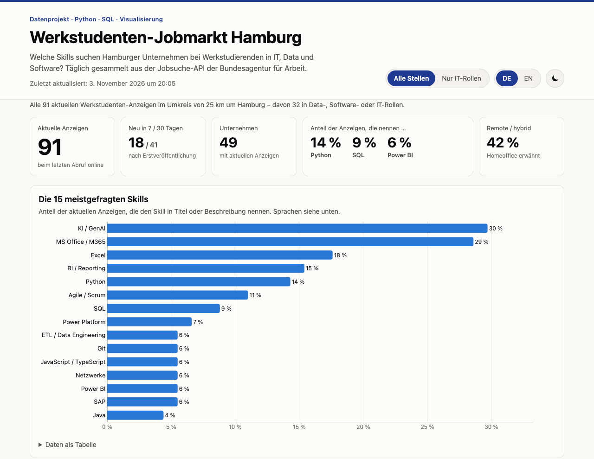
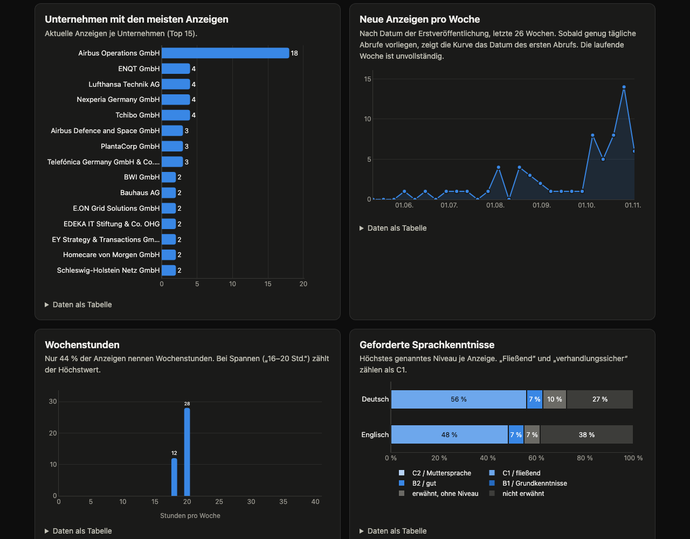
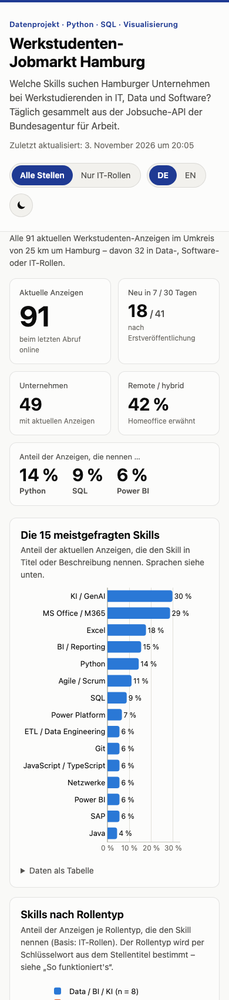
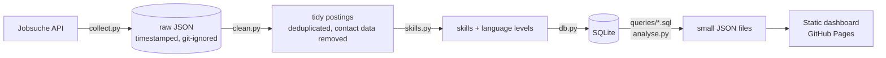

# Hamburg IT Working-Student Job Market Dashboard

**Which skills do Hamburg employers ask for when they hire working students (Werkstudierende) in IT, data and software?**
This project collects job postings daily from the German Federal Employment Agency's public API, cleans and stores them in SQLite, analyses them with plain SQL and publishes an interactive, bilingual dashboard on GitHub Pages.

**Live dashboard:** `https://YOUR-USERNAME.github.io/hamburg-werkstudent-dashboard/` <!-- replace after enabling Pages -->



<p>
  
  
</p>

---

## Why

As a student looking for a working-student job in Hamburg, I wanted to know which skills are actually requested – not from blog posts, but from the job ads themselves. The project is also a compact demonstration of the full data workflow: **API → raw data → cleaning → database → SQL → visualisation → automation**.

## First findings (3 November 2026, 91 postings)

- **The search is fuzzy.** Only 32 of 91 "Werkstudent IT/Data/Software" results are actually data, software or IT roles; the rest are marketing, tax, HR or engineering jobs. The dashboard lets you switch between both views.
- **SQL is the most requested hard skill in IT roles** (25 %), ahead of Python (22 %) and Power BI (16 %). In data roles, BI/reporting (63 %), Python and SQL (50 % each) dominate.
- **AI is everywhere – machine learning is not.** 30 % of postings mention AI (mostly *using* AI tools), but only one posting asks for actual ML skills.
- **German matters:** 56 % of postings require German at C1 level or higher.
- **Hours are standard:** where stated (44 % of postings), it is always 18 or 20 hours per week.

These numbers update daily on the live dashboard.

## Data source

[Jobsuche API of the Bundesagentur für Arbeit](https://jobsuche.api.bund.dev/) (documented by bund.dev):

| Endpoint | Used for |
|---|---|
| `GET /pc/v6/jobs` | search (`was`, `wo=Hamburg`, `umkreis=25`, paging) |
| `GET /pc/v4/jobdetails/{base64(refnr)}` | full description text |

- Authentication is the public client id `jobboerse-jobsuche` from the official docs (header `X-API-Key`). It can be overridden via the `JOBSUCHE_API_KEY` environment variable / GitHub Secret.
- Note: the older `/pc/v4/jobs` search endpoint used in many tutorials now returns **403**.
- **No scraping.** LinkedIn, StepStone and Indeed forbid it, so they are deliberately not used.
- The collector waits 1 s between requests, retries on 429/5xx and caches detail pages, so daily runs only fetch new postings locally.

## Pipeline



| Step | File | What it does |
|---|---|---|
| 1 | [`src/collect.py`](src/collect.py) | Searches 6 configurable terms, pages through results, saves raw JSON per run with a timestamp, fetches and caches detail texts. Aborts if the API returns nothing. |
| 2 | [`src/clean.py`](src/clean.py) | Builds one tidy row per posting: title, company, district, posted / first-seen / last-seen dates, contract, working time, weekly hours, remote/hybrid, role type, source URL. **Two-pass deduplication** (same reference number across search terms; same normalised title + company for monthly re-posts). **Scrubs emails, phone numbers and recruiter names.** |
| 3 | [`src/skills.py`](src/skills.py) | Matches a transparent keyword dictionary ([`dictionaries/skills.yaml`](dictionaries/skills.yaml), 35 skills with synonyms) against title + description and detects the required German/English level (C2 … B1). |
| 4 | [`src/db.py`](src/db.py) | Loads everything into SQLite with **incremental upserts**, so the database doubles as the long-term history. |
| 5 | [`src/analyse.py`](src/analyse.py) | Runs every query in [`queries/`](queries/) for "all postings" and "IT roles only" and exports small JSON files. Refuses to export anything that looks like contact data. |
| 6 | [`docs/`](docs/) | Static dashboard (HTML/CSS/JS + Plotly.js 2.35.2 pinned with SRI). No backend. |

### Database

```
runs(run_id PK, started_at, finished_at, location, radius_km, unique_postings, details_fetched, postings_per_term)
postings(posting_id PK, dedup_key UNIQUE, refnr, title, company, city, postcode, district,
         posted_date, first_seen_date, last_seen_date, offer_type, working_time, contract,
         hours_min, hours_max, work_mode, role_category, german_level, english_level,
         n_versions, source_url, description)
skills(skill_id PK, label, category)
posting_skills(posting_id FK, skill_id FK, matched_in, PK(posting_id, skill_id))
view current_postings  -- postings seen in the latest run
```

Full schema with constraints and indices: [`queries/schema.sql`](queries/schema.sql). Every dashboard number comes from a readable SQL file, e.g. the skill share per role type:

```sql
-- queries/skills_by_role.sql (excerpt)
WITH scope AS (
    SELECT * FROM current_postings
    WHERE (:it_only = 0 OR role_category <> 'other')
),
role_totals AS (
    SELECT role_category, COUNT(*) AS total FROM scope GROUP BY role_category
),
top_skills AS (
    SELECT ps.skill_id
    FROM scope
    JOIN posting_skills AS ps USING (posting_id)
    JOIN skills         AS s  USING (skill_id)
    WHERE s.category <> 'language'
    GROUP BY ps.skill_id
    ORDER BY COUNT(*) DESC, ps.skill_id
    LIMIT 12
)
SELECT rt.role_category, s.label,
       ROUND(100.0 * COUNT(ps.posting_id) / rt.total, 1) AS share_pct
...
```

Other queries: [KPIs](queries/kpis.sql), [top skills](queries/top_skills.sql), [top companies](queries/top_companies.sql), [weekly postings with a recursive CTE for empty weeks](queries/weekly_postings.sql), [hours](queries/hours_distribution.sql), [skill co-occurrence](queries/skill_cooccurrence.sql), [language levels](queries/language_levels.sql), [table rows](queries/current_postings_table.sql).

## Dashboard

- KPI tiles: current postings, new in 7 / 30 days, companies, share mentioning Python / SQL / Power BI, remote/hybrid share
- Top 15 skills; skills by role type (data vs. software vs. IT support/security)
- Top hiring companies; new postings per week; weekly hours; language requirements
- Skill co-occurrence heatmap of the top 10 skills
- Searchable, filterable, sortable table of current postings with links to the original ads and a CSV download
- "How it works" pipeline diagram and methodology notes
- German (default) and English, light and dark mode, responsive down to 375 px
- Accessible: every chart has a "show data as table" view, the palette is checked for colour-vision deficiencies, and controls work with keyboard and screen readers

To match your own site, change `--accent` in [`docs/assets/style.css`](docs/assets/style.css) and fill in `AUTHOR` at the top of [`docs/assets/app.js`](docs/assets/app.js).

## How to run

Requires Python 3.11+.

```bash
python -m venv .venv && source .venv/bin/activate
make install          # pip install -r requirements.txt
make all              # collect → clean → skills → SQLite → JSON export (~2 min on first run)
make serve            # open http://localhost:8000
```

| Command | Purpose |
|---|---|
| `python run.py` | the whole pipeline (same as `make all`) |
| `python run.py --skip-collect` | rebuild database and exports from cached raw data, no API calls |
| `make test` | run the pytest suite |
| `make check-privacy` | scan everything git would publish for emails, phone numbers, secrets and description texts |
| `make history` | rebuild `data/history.db` the way CI does |

Search terms, location, radius and the request pause live in [`config.yaml`](config.yaml).

## Automation

[`.github/workflows/pipeline.yml`](.github/workflows/pipeline.yml) runs every day at 05:17 UTC (and on demand):

1. run the tests and the privacy check
2. collect, clean, load and export (`python run.py`)
3. privacy check again on the fresh data
4. commit `docs/data/` and `data/history.db`, then deploy `docs/` to GitHub Pages

A push to `main` runs the tests and redeploys the dashboard without fetching new data.

**Setup:** *Settings → Pages → Source: GitHub Actions.* No secret is required; `JOBSUCHE_API_KEY` is optional.

**Why a separate `history.db`?** Raw API responses are never committed, so CI needs the database itself to remember first-seen dates across days. CI runs with `KEEP_DESCRIPTIONS=false`: description texts are used for skill extraction and then deleted, and the file is VACUUMed. The committed database therefore contains no ad texts – only the same fields the dashboard already shows. The privacy check fails the build if any text remains.

## Privacy

- Raw API responses (`data/raw/`) can contain recruiter names, emails and phone numbers. They are git-ignored and never leave the machine.
- `clean.py` removes contact lines, emails (also `name(at)firma(dot)de`), phone numbers and "Frau/Herr …" names before anything is stored.
- Exports contain no description text at all, and `analyse.py` aborts if an export looks like it contains contact data.
- [`scripts/check_privacy.py`](scripts/check_privacy.py) scans every file git would publish (including the SQLite history) before each commit in CI.

## Methodology and limitations

- **Coverage:** only the BA job board. Many companies post working-student jobs only on their own career pages or LinkedIn, so this is a slice of the market, not all of it.
- **Role type** is a keyword rule on the job title (data → software → IT, first match wins; [`dictionaries/roles.yaml`](dictionaries/roles.yaml)). Rough but transparent.
- **Skills are mentions**, not requirements: "Python is a plus" and "Python required" count the same, and company boilerplate counts too.
- **Keyword matching is approximate.** Real false positives found and fixed during development: German "Netzwerk" usually means professional networking, "Data Science" usually a degree subject, "Programm" a programme, "Engineering" aerospace engineering.
- **Weekly hours, remote and district** are derived from free text or postcodes and are only as good as the posting.
- **Small numbers:** with 8–16 postings per IT role type, one posting moves a share by 6–12 percentage points.
- **The time series** grows with daily runs. Until there are four weeks of runs, the weekly chart uses the API's publication date.

## Project structure

```
├── config.yaml              search terms, location, paths
├── dictionaries/            skills.yaml, roles.yaml, hamburg_districts.yaml
├── queries/                 schema.sql + one .sql file per metric
├── src/                     collect, clean, skills, db, analyse, config
├── scripts/check_privacy.py pre-publish check
├── tests/                   pytest suite (81 tests)
├── docs/                    the dashboard (GitHub Pages root) + data/*.json
├── data/history.db          CI history (no ad texts); data/raw/ and data/jobs.db stay local
├── run.py, Makefile
└── .github/workflows/pipeline.yml
```

## Testing

`make test` runs 81 pytest tests, including:

- **cleaning edge cases:** gender markers in titles (`Werkstudent*in`, `(m/w/d)`, `(gn)`), company suffixes ("Werk Bremen", "Abteilung …"), HTML entities, hours like "19,5 Std." or "zwischen 3 und 19,5", semester-break and internship clauses, multi-location postings
- **deduplication:** across search terms, across runs, and monthly re-posts with new reference numbers
- **contact scrubbing**, including obfuscated emails, and no false hits on dates and postcodes
- **skill extraction:** synonyms, case, and known false positives (JavaScript ≠ Java, NoSQL ≠ SQL, "exzellent" ≠ Excel, "R&D" ≠ R)
- **language levels**
- **database:** idempotent upserts, skills kept after texts are dropped, no text left in the file after VACUUM
- **export:** every SQL file runs, the privacy guard works, and no description text appears in any export

## What I learned

- **Check the API before trusting tutorials.** The search endpoint most examples use was already retired (403); reading the current OpenAPI spec and probing it first saved time.
- **Deduplication needs domain knowledge.** Removing exact duplicates was not enough – employers re-post the same job every month under a new ID, which only shows up after normalising titles (`Werkstudent*in` vs. `Werkstudentin (w/m/d)`).
- **Look at the matches, not just the counts.** Every surprising number (19 % "networking", 11 % "machine learning") turned out to be a keyword problem. Reading the context of matches and writing a test for each false positive made the analysis trustworthy.
- **Privacy is a pipeline property.** Contact data was in 22 of 102 raw descriptions. Scrubbing early, never exporting free text, and an automated check before each commit is more reliable than one manual review.
- **Keep SQL as SQL.** Separate `.sql` files with CTEs (and a recursive CTE for empty weeks) are easier to read, test and show than queries hidden in Python strings.
- **Design for the incremental case.** Upserts by a stable key and recomputing derived columns let the same code run locally on full history and in CI with only today's data.

## CV / portfolio description

**Deutsch:**
> **Werkstudenten-Jobmarkt Hamburg – Daten-Dashboard** (Python, SQL/SQLite, Plotly, GitHub Actions): Automatisierte Pipeline, die täglich Stellenanzeigen über die Jobsuche-API der Bundesagentur für Arbeit sammelt, bereinigt, dedupliziert und datenschutzkonform in SQLite speichert.
> Skill-Analyse mit transparentem Keyword-Wörterbuch und SQL-Abfragen, veröffentlicht als zweisprachiges, interaktives Dashboard auf GitHub Pages; 81 pytest-Tests.

**English:**
> **Hamburg Working-Student Job Market Dashboard** (Python, SQL/SQLite, Plotly, GitHub Actions): Automated pipeline that collects job postings daily from the German Federal Employment Agency's API, then cleans, deduplicates and stores them privacy-safely in SQLite.
> Skill analysis with a transparent keyword dictionary and plain SQL, published as a bilingual interactive dashboard on GitHub Pages; 81 pytest tests.

## Attribution

Job data: Bundesagentur für Arbeit, via the [Jobsuche API](https://jobsuche.api.bund.dev/) documented by [bund.dev](https://bund.dev). This project is not affiliated with the Bundesagentur für Arbeit. Each table row links to the original posting.
